# 浣熊火箭：无名氏危机

2026 Qoder 高校创造力大赛 · LifeHack 生活娱乐赛道参赛作品

> 一只背着废铁火箭的浣熊，在“梗的名字被偷走”的世界里横版闯关——认对热梗，就能反弹 Boss 的招式、夺走它的力量。知识越懂，打得越帅。

## 当前版本

- 第一幕「发布会大厦」已形成可玩闭环：标题 → 两道名字门 → 紫色奶娃主持人「灭霸」登场 → 三阶段 Boss → 击败台词 → 半张面单过场 → 结算 → 重试/声明
- 第二幕「荒野岛」已形成可玩闭环：第一幕结算「前往荒野岛」→ 取景框教学 → 断桥导弹 → 两道名字门 → 荒哥登场 → 假胜利「十倍杠杆」→ 双血条 / 挂钩弹反 → 正式结算 → 重试/返回标题
- 两幕名字门分别记录答题、奖励和检查点状态；从第一幕进入、第二幕重试或复活时不会串用旧记录
- 荒哥第一管血打空只播放假胜利，第二管血上限与当前血量均为第一管的 2 倍（720 → 1440）；第二管后半段沿用原第三阶段招式
- 灭霸与荒哥的关键招式均接入弹反、硬伤、硬直和掉卡流程；原三连冲刺四拍音效保留为灭霸专属记忆
- 两幕加入“已签收，请退后”盖章陷阱与“快递原路退回”返件陷阱，补给、站位和冲刺时机都参与风险判断
- 6 条敌人/角色语音接入 WebAudio、字幕与单句仲裁；龙虾击破台词使用原创「过载了，请重新取号。」
- 支持桌面键盘与手机横屏触控；手机可直接点选答案和梗卡
- 公开试玩站已发布两幕完整版：<https://raccoon-rocket-ajj0fzwid68.qoder.zone>（线上当前为 `c684a88` 构建；本次发布前优化已在 `feature/release-polish` 验证并合并 `main`，最终构建待重新发布）
- 功能细节、实测记录和未验证项见 [开发进度](docs/开发进度.md)

### 本地运行

```bash
npm install
npm run dev      # http://127.0.0.1:5173
npm run typecheck
npm run build    # 类型检查 + 生成 dist/
npm run preview  # 预览 dist/
```

生产预览如需使用浏览器验收句柄，在地址后加 `?debug=1`；正常游玩地址不会暴露该句柄。

第一幕地面碰撞回归（先构建并在另一终端启动 `npm run preview -- --port 5201`）：

```bash
npm run test:act1-floor -- http://127.0.0.1:5201/
```

第一幕公开试玩：<https://raccoon-rocket-ajj0fzwid68.qoder.zone>

## 从首页怎么玩到两个 Boss

1. **代签单**：从标题点「开始」，沿发布会大厦向右到收发室。靠近门口的包裹按 `E` 按铃，机器吐出小票。看清「收件人：灭霸 / 代签人：灭建国 / 与收件人关系：父」，回答「谁替灭霸签了包裹？」选 **灭建国**。答对后机器盖「代签有效」，尾巴卷走签收联，门闩打开并进入梗卡三选一。
2. **365 里路**：继续向右到取件窗口，按 `E` 按铃。窗口沿轨道滑远，路线单会显示纸路一头连窗口、一头缠着双轴磁带机。回答「按哪个键，能把这条路收回来？」选 **倒带**。线轴反转、窗口被拖回，取件铃响后窗口开成 Boss 房入口。
3. **又是类魂 / 全自动签收**：进入 Boss 房首次会播放约 4 秒登场，可等完或按空格/点击跳过。第一阶段会先演示机器人浇萝卜、巨章盖出「类魂」，再弹出「机器把种菜分到了哪一类？」；选 **类魂**。第二阶段奶娃举三枚章并重新展开代签单，问「代签人是谁？」；选 **灭建国**。答对会甩尾弹章、反伤并进入硬直，趁此继续 `J` 射击。第三阶段保留原高潮招式，清空血条后会看到灭霸放下公章，阿浣说「灭霸这个扎啤」，再进入半张面单过场与结算。
4. **前往荒野岛**：第一幕结算页点「前往荒野岛」。登陆后先看无人机对空箱演示：地面角框合拢、快门一响、补给网只罩住箱子；第二框会转向阿浣，在角框合拢前移动或冲刺即可躲开。走到断桥前会冻结镜头演示同一发射口的导弹；之后可在松动桥板处**退一步等导弹掠过再跳**，也可**起跳后把二段跳留给导弹轨迹**。首门「想链接了」先看挂钩拖走路牌，再答 **亡命天涯**，阿浣抓住回弹的绳子放下断桥；第二门「这是好事呀」答 **水桶变重，吊起货架**，货架升起后通行。
5. **十倍杠杆与挂钩弹反**：荒哥战先正常射击打空第一管血；这里不会结算、存档或掉卡，只会播放「十倍杠杆」和双倍血条展开。第二管血开场看钩子追踪，移动或冲刺躲开后答题「刚才被它拖走的是？」选 **路牌**；阿浣甩尾把钩扣回自拍杆，反伤并给出长硬直。第二管后半段沿用 **放松滑轮，雨棚兜住荒哥** 的招式。真正清空第二管血后，荒哥喝水并把节目牌翻到「本期拍摄完毕」，进入第二幕正式结算。

桌面操作：`A/D` 移动，`空格` 二段跳，`J` 射击，`K` 冲刺，`E` 交互，`1/2/3` 作答，`Z/X/C` 使用梗卡，`M` 静音。手机横屏使用屏幕按键，答案与梗卡直接点选。

## 实机截图

| 紫色灭霸 · 最后阶段 | 阿浣击败台词 |
|---|---|
| 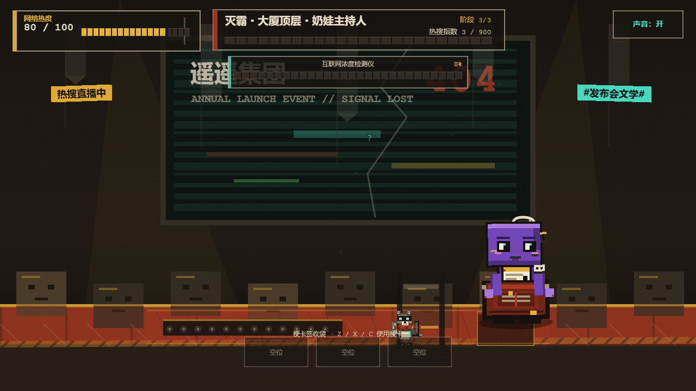 | 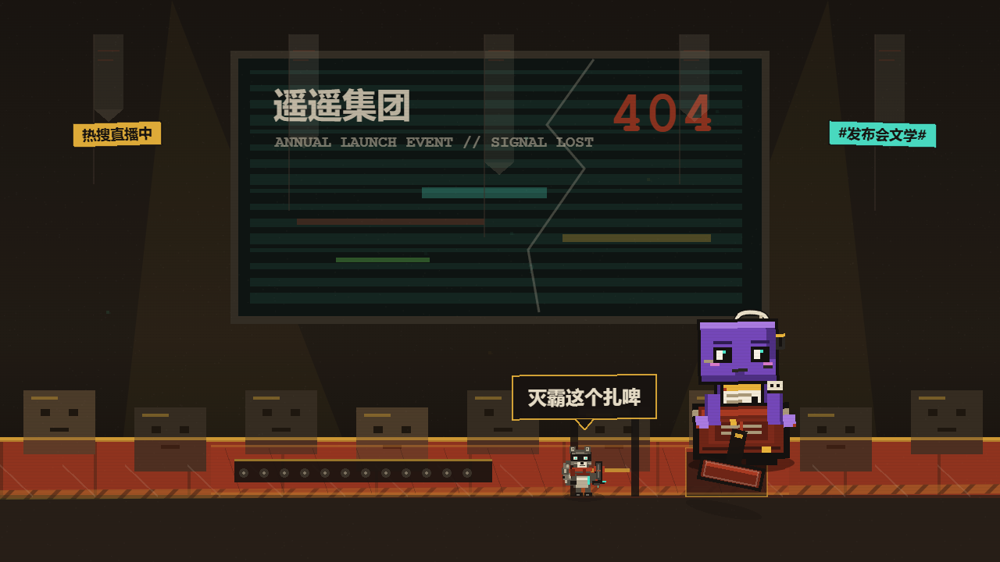 |

| 奶娃登场 | 「又是类魂」演示 |
|---|---|
| 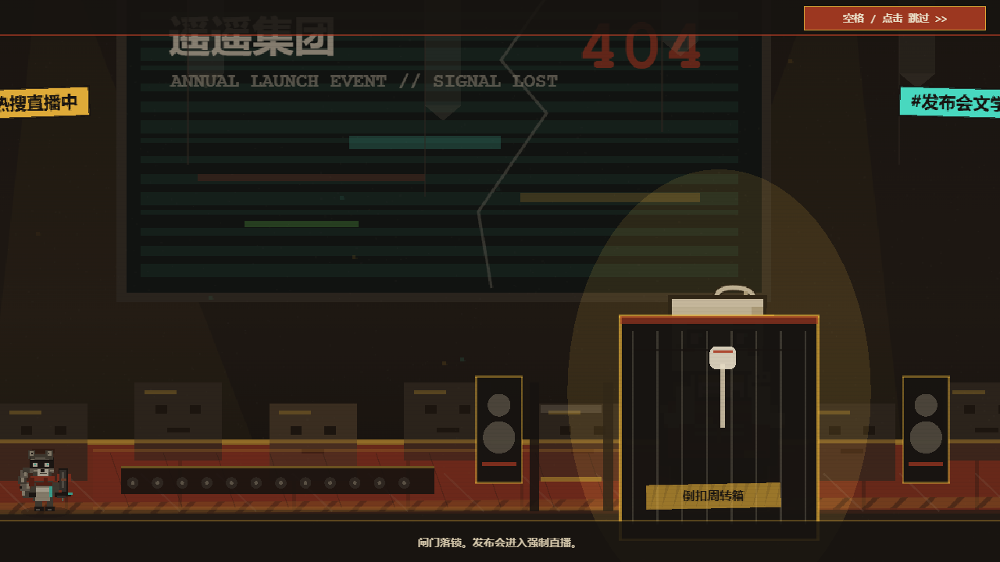 | 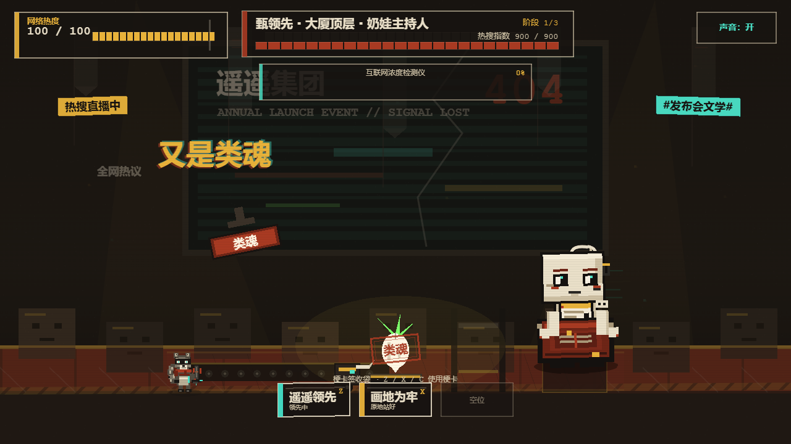 |

| 全自动签收 | 弹反后的「类魂」标签 |
|---|---|
| 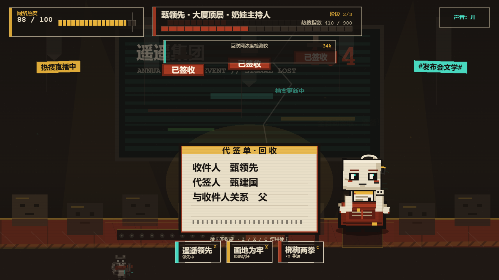 | 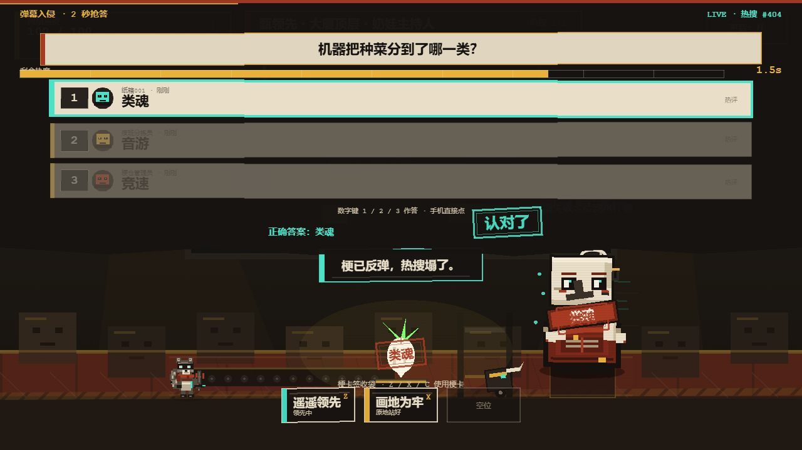 |

| 第二阶段签收反打 | 手机横屏答题 |
|---|---|
| 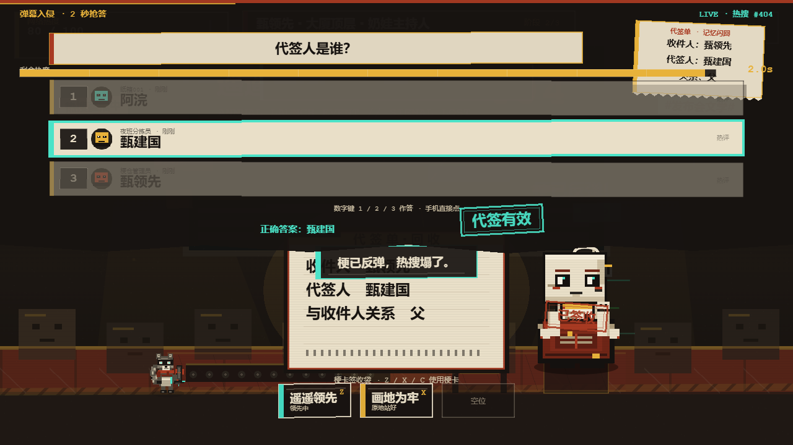 | 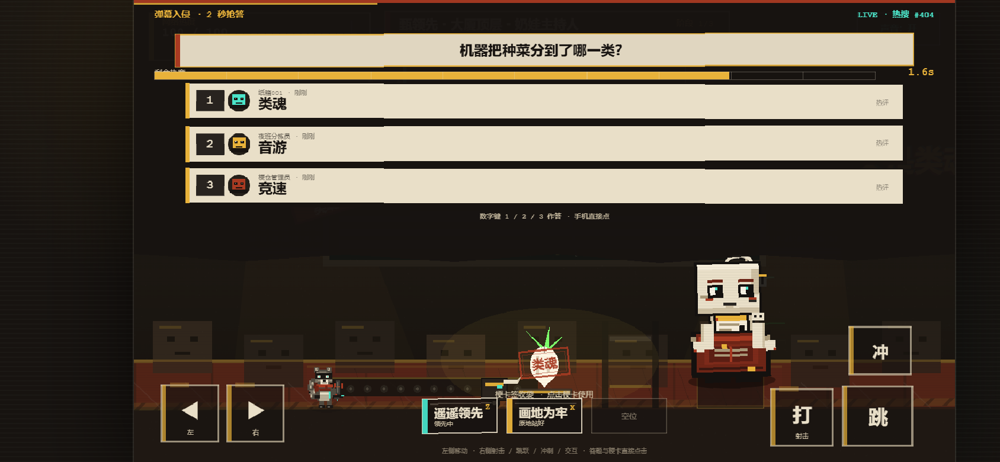 |

| 荒野岛登陆 | 首门「亡命天涯」 |
|---|---|
| 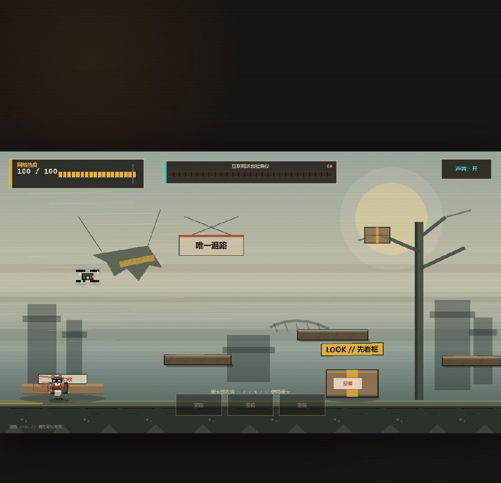 | 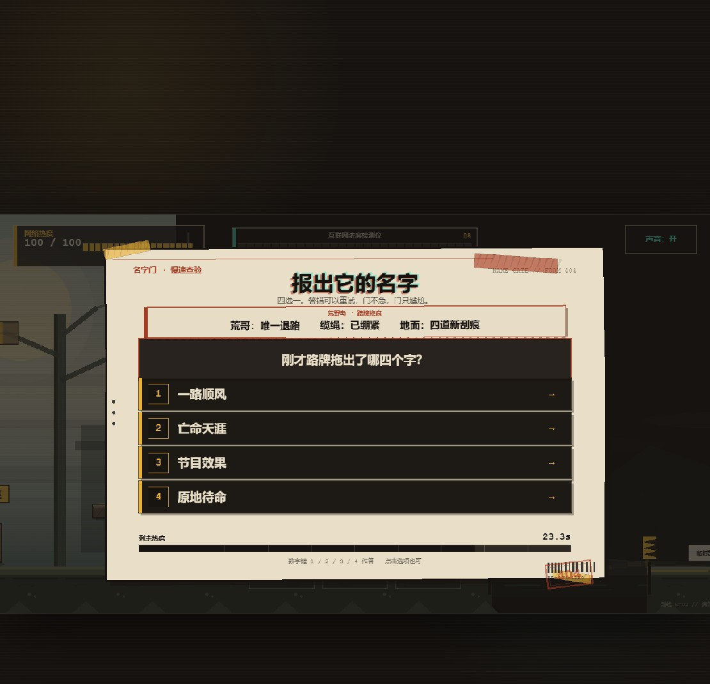 |

| 荒哥第三阶段 | 第二幕结算 |
|---|---|
| 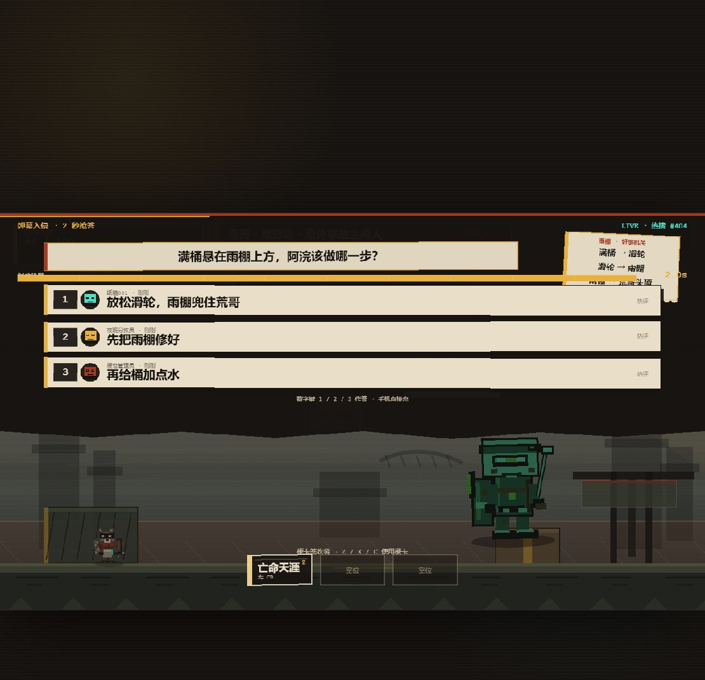 | 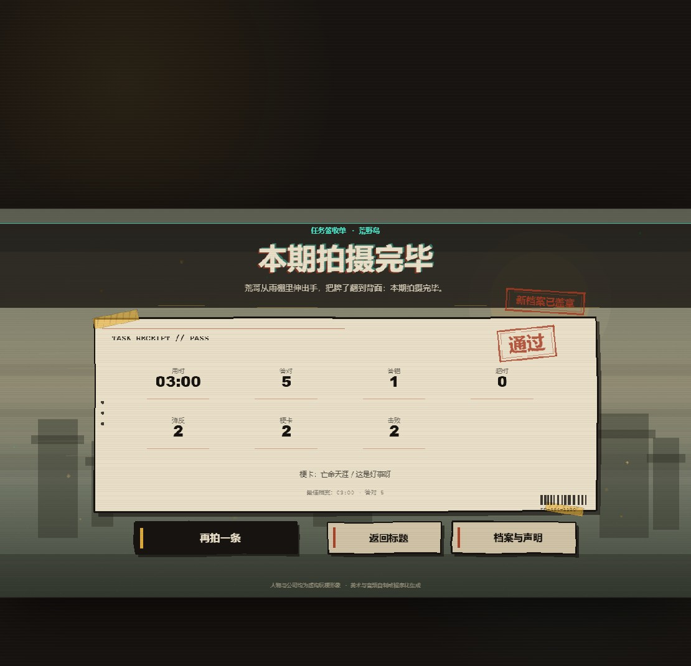 |

| 「十倍杠杆」假胜利 | 第二阶段挂钩题 |
|---|---|
| 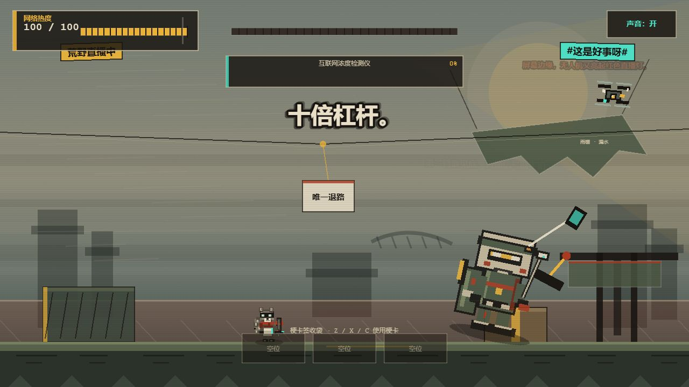 | 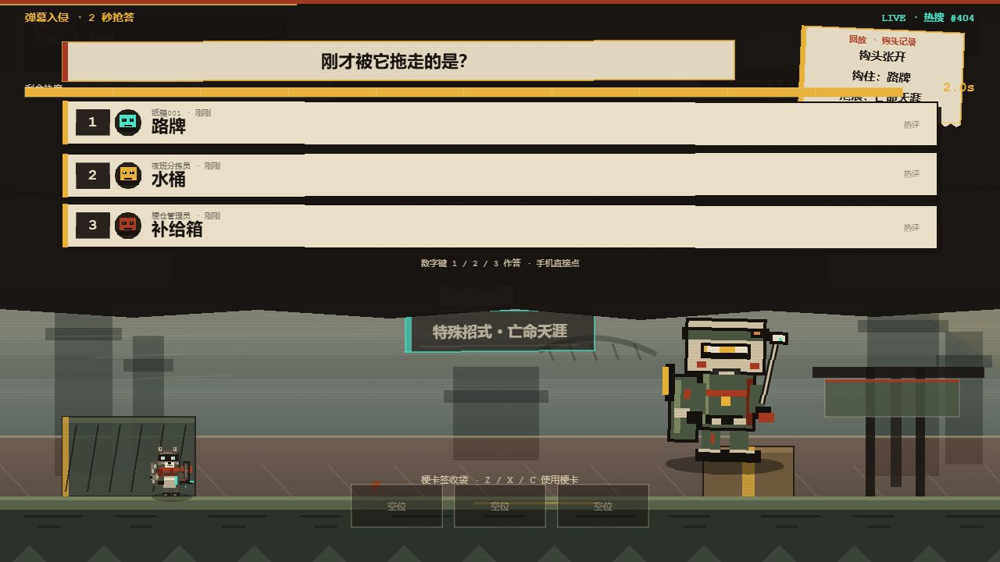 |

## 选题思路

- **赛道现状**：LifeHack 已发布作品中，单机小游戏（肉鸽/割草/人生模拟）、照片生成（表情包/室友漫画）、桌宠类高度扎堆；"音乐与视觉实验""社团工具"几乎无人占位
- **差异化定位**：不做"又一个平台跳跃"，而是把**认梗做成唯一成长资源与战斗核心**——Boss 出招时 2 秒内认出对应热梗即可"完美弹反"，答对越多打得越强
- **题材安全**：角色均为虚构梗化形象（如"灭霸""荒哥"），不出现真实姓名、公司与 Logo；不含真人肖像与真实事件改编

## 核心玩法

- 横版跑跳 + 射击推进，3–5 分钟一局
- **梗弹反**：Boss 释放标志性招式时弹出梗名选项，2 秒内作答——正确 = 硬直反噬 + 夺卡，错误 = 吃伤害并给出提示
- **名字门**：慢速四选一答题，答对开门并抽取"梗卡"（如水/画地为牢/广智救我）
- **梗浓度**：连对累积能量槽，满槽触发"全民玩梗"爆发模式
- 当前关卡：发布会大厦（Boss：灭霸）→ 荒野岛（Boss：荒哥）；两幕均已包含名字门、检查点、重试与结算

## 技术方案

| 项 | 选型 |
|---|---|
| 引擎 | Phaser 3（MIT） |
| 构建 | Vite + TypeScript；主程序与 Phaser vendor 分包 |
| 形态 | 纯静态网页（无后端），部署 Qoder Sites public |
| 数据 | 本地 JSON 题库/卡池 + localStorage 进度 |

## 文档

- [开发文档](docs/开发文档.md)：完整设计、技术架构、数据结构、排期与验收清单
- [开发进度](docs/开发进度.md)：已实现内容、实测记录、已知问题与下一步

## 团队

- [@hahaandxixi](https://github.com/hahaandxixi)
- [@Komihida](https://github.com/Komihida)

## 声明

本作品为本次大赛期间原创；人物均为虚构玩梗形象，纯属娱乐，与任何真实人物无关。角色、场景、UI 与音效/配乐均由代码程序化生成；角色语音为 6 条系统 TTS 生成的占位 MP3（Windows Microsoft Huihui Desktop，非队伍真人录音，非商业歌曲或影视片段），字幕同步，后续可替换；正式公开评审前需由队内音频负责人确认系统语音许可。按团队先前明确要求，保留了「浮木」「扎啤」等内部梗，未使用影视原声、真人肖像或第三方美术素材。
